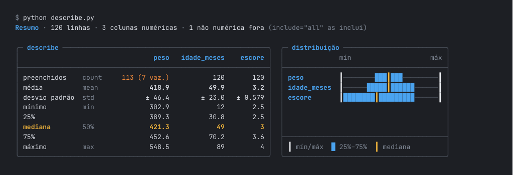
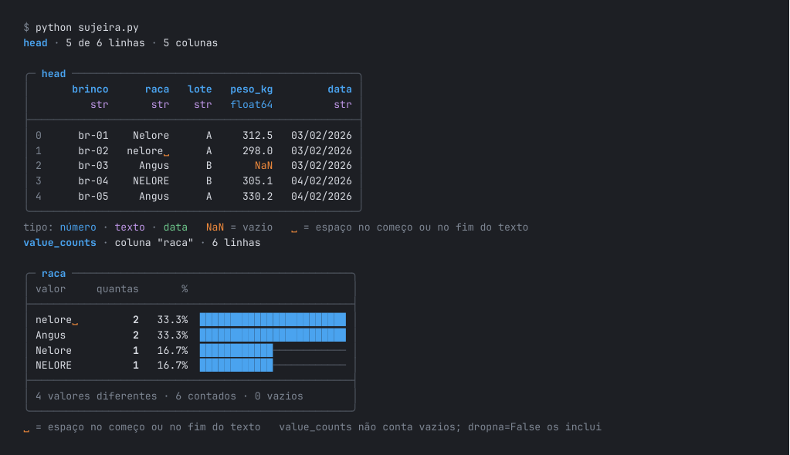
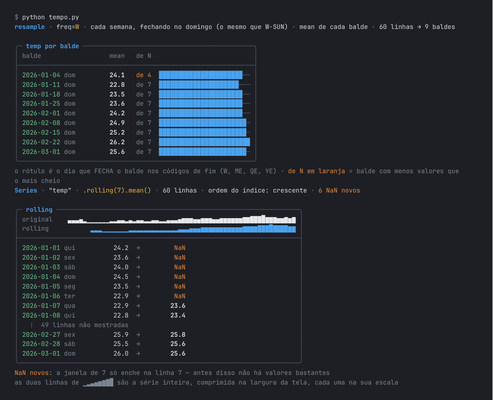

# rattlesnake

**O chocalho do pandas no terminal.** O `print` do pandas, relido — sem mudar uma linha do seu código.

```python
print(df.describe())      # você escreve exatamente o que já escrevia
```



O comando se chama `ratt`. Ele liga a releitura num ambiente Python, e a partir dali todo
`python x.py` daquele ambiente mostra a saída do pandas assim: medidas em português ao lado do
nome original, os vazios em laranja, a distribuição em barras, o que mudou depois de um filtro.

## Por que cascavel

O chocalho existe para **avisar antes**. É o que a releitura faz com o que o pandas imprime e
ninguém vê: o espaço sobrando em `"nelore "`, o peso que está vazio, o `count` que não é o número
de linhas, a semana que falta num índice de datas, o "de N" que uma média não conta.

Ela avisa — **não decide**. Nenhum template diz "use a mediana" ou "essa coluna é assimétrica":
ela mostra os fatos que levam a uma conclusão, e a conclusão é de quem lê.

## O que muda e o que não muda

- **Os comandos não mudam.** `print(df.describe())` continua sendo `print(df.describe())`.
- **É só visual.** O objeto que o pandas devolve é o mesmo; nada é recalculado nem alterado.
- **O nome original fica à vista.** `média` vem ao lado de `mean`, `mediana` ao lado de `50%`:
  o pandas cru continua legível em qualquer outra máquina.
- **Só no terminal.** Redirecionou para arquivo (`python x.py > saida.txt`)? Sai o texto original.
- **Nunca come uma saída.** Se algo falhar dentro da releitura, o `print` original roda.

## Instalação

São dois passos: instalar o comando, e ligar a releitura onde você quer.

**1. O comando `ratt`**, uma vez por máquina:

```bash
pipx install git+https://github.com/GF-Linux/rattlesnake.git
# sem pipx:
python3 -m pip install --user git+https://github.com/GF-Linux/rattlesnake.git
```

**2. Ligar** — em um projeto, ou no seu usuário:

```bash
cd meu-projeto
python -m venv .venv          # se o projeto ainda não tem ambiente virtual
ratt install                  # liga só aqui

ratt install --global         # liga no python3 do seu usuário, em qualquer pasta
```

| | onde liga | vale para |
|---|---|---|
| `ratt install` | o ambiente virtual da pasta (`.venv/`, `venv/`, `env/`) ou o ativo | só quem usa aquele ambiente |
| `ratt install --global` | a pasta de pacotes do usuário daquele Python | aquele Python em qualquer pasta — **menos dentro de um ambiente virtual**, que existe justamente para isolar isso |

**pyenv:** uma pasta que só tem `.python-version` escolhe o *interpretador*, mas não isola
pacotes — eles são compartilhados por todo projeto da mesma versão. Por isso o `ratt install`
recusa e explica; crie um `.venv` na pasta, ou use `--global` sabendo que vale para a versão
inteira.

**distrobox / toolbox:** o container enxerga a mesma pasta pessoal, mas o Python de dentro é
outro. Instale o `ratt` e rode `ratt install` também lá dentro.

## Comandos

```
ratt                     sem nada, num terminal, abre o menu
ratt -h                  a ajuda (ratt <comando> -h: a de um comando)
ratt install [--global]  liga a releitura
ratt uninstall           desliga  (--global · --all: de todo lugar)
ratt status              onde está ligada, em que versão, e se esta pasta tem
ratt templates           o que é relido, e como aparece
ratt check-update        procura uma versão nova e mostra o que mudou
ratt upgrade             procura, mostra o que mudou e pergunta [s/N] antes de instalar
ratt sync                reescreve a releitura em todo lugar, com a versão deste ratt
ratt db                  a tela do banco: a árvore à esquerda, dados e estrutura à direita (d: o diagrama · e: editar os dados)
ratt db status           o PostgreSQL: o que está instalado, ligado e configurado (ratt db -h)
ratt db setup            o PostgreSQL do zero até o primeiro banco, em Debian/Ubuntu, Fedora/RHEL e Arch
ratt db list             os bancos, com dono e tamanho
ratt db connect [banco]  abre o psql no banco; sem nome, escolhe da lista
ratt db run <a.sql>      roda o .sql comando por comando (--dry-run · --watch)
ratt db new <banco>      cria um banco (--owner: outro dono)
ratt db user             os usuários; user add cria, user passwd troca a senha
ratt db reset            apaga todos os bancos e usuários (backup antes) e volta ao antes do setup
```

O `upgrade` segue o espírito do `dnf upgrade --refresh`: busca a versão no repositório, mostra
as novidades deste [CHANGELOG](CHANGELOG.md), pergunta, atualiza o `ratt` do jeito que ele foi
instalado (pipx ou pip) e reaplica a releitura em todo lugar onde ela está ligada.

## ratt db — o PostgreSQL no terminal

O outro braço do ratt é a releitura do DBeaver: configurar, escrever e ver o banco sem sair do
terminal. Os comandos são em inglês; a interface, em português ou inglês (`ratt db lang en`).

```bash
ratt db setup                 # do zero até o primeiro banco: instala, inicializa, liga, senha, usuário
ratt db new estudos           # um banco novo, que vira o atual
ratt db run 01-tabelas.sql    # o .sql do VS Code, comando por comando (--dry-run · --watch)
ratt db                       # a tela: a árvore do banco, os dados, a estrutura, as relações, o SQL
```

O jeito de trabalhar: o `.sql` aberto no VS Code, `ratt db run --watch arquivo.sql` no terminal
dele, e a tela (`ratt db`) num terminal ao lado — ela se atualiza sozinha quando o script cria
uma tabela ou muda dados. Na tela, `p` abre o `psql` no banco e `\q` volta.

### O diagrama das tabelas (o canvas)

Na tela, `d` abre o diagrama do schema: cada tabela é uma caixa, cada chave estrangeira é uma
linha entre elas — `<` do lado "muitos", `┼` do lado "um", `o` quando a coluna aceita vazio:

```
┌─ users ───────────────┐         ┌─ users_roles ─────┐             ┌─ roles ──────┐
│ PK id          bigint ├┼┬──────<┤ PK user_id bigint │           ┌┼┤ PK id bigint │
│    first_name    text │ o       │ PK role_id bigint ├>──────────┘ │    name text │
│    last_name     text │ │       └───────────────────┘             └──────────────┘
│    email         text │ │
│    password_hash text │ │
└───────────────────────┘ │
                          │
                          │       ┌─ profiles ──────────┐
                          │       │ PK id        bigint │
                          │       │    bio         text │
                          │       │    description text │
                          └──────<┤    user_id   bigint │
                                  └─────────────────────┘
```

As teclas principais: `a` nova tabela, `c` nova coluna, `l` ligar (ou ligar "como N:N"),
`espaço` o menu da coluna (renomear, obrigatória/opcional, única), `x` apagar (mostrando o que
cai junto), `u` desfazer, `f` / `F` foco numa tabela e suas vizinhas (no máximo 25) / tudo,
`+` abre a tabela muito referenciada que aparece recolhida com `←N`, `s` troca o schema, setas
e `PageUp` / `PageDown` rolam, `shift` com as setas move a caixa, `Esc` volta.

Um `⚠` ao lado de uma tabela ou coluna marca um aviso (tabela sem chave primária, chave
estrangeira sem índice ou que aceita vazio); a linha logo acima do painel do SQL diz, em
palavras, os avisos do que está selecionado.

O que você edita vira um rascunho: o SQL fica sempre à vista embaixo do desenho (`r` leva o
foco até ele), com o nome do schema em cada tabela (`public.users`). `enter` aplica —
mostrando o SQL, e no alto o que ele apaga, e pedindo a confirmação —, `e` ensaia (roda e
desfaz) e `w` salva o SQL num `.sql`. O SQL gerado é só leitura e exportação: para editá-lo,
`w`, depois o VS Code e o `ratt db run`.

O rascunho de cada schema fica guardado em `~/.local/share/ratt/canvas/{porta}-{banco}/`
(ou em `$XDG_DATA_HOME/ratt/canvas/…`), junto com as posições das caixas; o SQL de cada
rascunho aplicado vai para a pasta `aplicados/` ali dentro, com a data e a hora no nome.

### Os dados da tabela (a tela Dados)

Na tela, `e` abre os dados da tabela escolhida na árvore (no canvas, é o `v`): inserir,
filtrar, alterar e apagar linhas, sempre vendo o SQL que sai.

```
ratt db · estudos › public.pessoas · Dados · rascunho: 2
filtro: nome começa com G e mês(nascimento) é maior ou igual a junho   (f condição · F limpa · t texto · o E/OU · ⌫ tira a última)
── 3 de 454 linhas ──────────────────────────────────────────────────────────────────
 id    nome        nascimento   email
 int8  text        date         text
 12    Gabriel     1990-07-14   gab@x.com
 87    Gláucia     1985-06-02   ∅
 203   Guilherme   1992-11-30   gui@x.com
! 3 linha(s) com nascimento vazia ficam de fora
┌ SQL ─────────────────────────────────────────────────────────────────────────────┐
│ -- o filtro:  SELECT … FROM public.pessoas WHERE nome ILIKE 'G%' … ORDER BY id;  │
│ -- 1. inserir em pessoas                                                         │
│ INSERT INTO public.pessoas (nome, email) VALUES ('Ana', 'ana@x.com');            │
└──────────────────────────────────────────────────────────────────────────────────┘
```

As teclas: `i` inserir (uma chave estrangeira se escolhe numa lista), `f` filtro, `o` troca E / OU,
`backspace` tira a última condição, `F` limpa o filtro, `t` escreve o `WHERE` em texto,
`m` altera as linhas filtradas, `x` apaga as filtradas, `D` apaga duplicatas, `n` / `N` páginas,
`u` desfaz, `enter` aplica, `e` ensaia, `w` salva num `.sql`, `r` leva o foco ao painel do SQL
e `Esc` volta.

**A grade mostra o banco como está; o que está no rascunho aparece depois de aplicar.** O
rascunho é o mesmo do canvas, e o aplicar confere: se um alterar ou apagar pegar um número de
linhas diferente do que você viu, tudo é desfeito e a operação é marcada — salvo quando uma
operação anterior do próprio rascunho mexe na mesma tabela (aí só mostra "pegou X, você viu Y").

As leituras e checagens da tela (contagens, avisos, a grade) usam comandos preparados
(*prepared statements*): atrás de um pgbouncer em modo `transaction` elas não funcionam —
conecte direto no PostgreSQL, ou use o pgbouncer em modo `session`.

Funciona nas famílias Debian/Ubuntu, Fedora/RHEL e Arch; `ratt db status` diz o que falta e
`ratt db reset` volta ao antes do setup (com backup e a trava do nome da máquina).

## O que é relido

`ratt templates` mostra a lista inteira. Em resumo:

| grupo | comandos |
|---|---|
| inspeção | `shape`, `describe` (números e texto), `head`/`tail`/`sample`, `print(df)`, `print(df["col"])`, `dtypes`, `columns`, `index`, `isna().sum()`, `nunique()`, `value_counts()` (contagem e proporção), `unique()` |
| transformação | filtros, e **qualquer** tabela ou coluna transformada (`sort_values`, `dropna`, `merge`, `.str`, `fillna`…): o que mudou em linhas, ordem, colunas e vazios; reduções (`mean`, `sum`…) com o "de N" |
| agrupamento | `groupby` (uma e duas chaves, `agg`), `pivot_table`/`unstack`, `crosstab`, `corr`, `pd.cut`/`pd.qcut` |
| tempo | `to_datetime`, `.dt`, índice de datas (ordem, passo, buracos, ritmo), `date_range`, `to_period`, `resample` com o "de N", `rolling`/`diff`/`shift`/`pct_change` |

A sujeira que o pandas não mostra:



O tempo, com a série inteira numa linha e o balde incompleto avisado:



**Tuplas:** se a sua função faz `return df, df.shape, df.head()` (ou você monta
`x = df.shape, df.head()`), o `print` recebe uma tupla — um objeto só, com os itens dentro. O
`ratt` relê cada item sozinho, com o template dele, e dá a cada um o nome que está no seu código.

Saem como o pandas escreve: o `info()`, números soltos (`print(df["x"].mean())`), tabelas com
índice de vários níveis e `print` com mais de um argumento (`print("total:", df.shape)`).

## O que mudou

### 0.2.0: tuplas relidas item por item

**A mudança.** Um `print` que recebe uma tupla com objetos do pandas agora relê cada item
sozinho, com o template dele, e dá a cada um o nome que está no código:

```python
def abrir_e_olhar(caminho):
    df = pd.read_csv(caminho, sep=";")
    return df, df.shape, df.dtypes, df.head(), df.isna().sum(), df.describe()

print(abrir_e_olhar("dados.csv"))     # ── 1/6 · df   ── 2/6 · df.shape   …   ── 6/6 · df.describe()
```

O mesmo vale para `x = df.shape, df.head()` seguido de `print(x)`, e para `print((df.shape, df.dtypes))`.

**O motivo.** Ela veio do primeiro uso real da 0.1.0. Uma função de "abrir e olhar", que devolvia
de uma vez o `df` e os seus cinco olhares (`shape`, `dtypes`, `head`, `isna().sum()`, `describe`),
saía crua no terminal. Com a vírgula, o `return` junta tudo numa tupla, e a 0.1.0 só relia um
objeto do pandas por `print`. Juntar os olhares numa função é um jeito natural de trabalhar, e a
ferramenta é que precisava acompanhar.

Na mesma leva, o mesmo uso mostrou que o `describe()` de muitas colunas de texto estourava a
largura da tela. Agora ele se divide em blocos, como o `head`.

O histórico completo está no [CHANGELOG](CHANGELOG.md).

## Desligar

```bash
RATT=0 python x.py           # o pandas cru, nesta execução
python x.py > saida.txt      # fora do terminal, já sai cru
ratt uninstall               # desliga do ambiente desta pasta
ratt uninstall --all         # de todo lugar
```

## Como funciona

O `ratt install` grava **dois arquivos** na pasta de pacotes do Python escolhido, e mais nada:

- `ratt_releitura.py` — a releitura, com a versão no topo;
- `ratt.pth` — uma linha que o Python lê ao começar: `import ratt_releitura; ratt_releitura.ligar()`.

`ligar()` troca o `print` daquele processo por um que olha o que vai ser impresso. Se é um
objeto do pandas, a saída é um terminal, e a linha que você escreveu é de um comando que tem
template, ele escreve a releitura; senão, chama o `print` original. Para mostrar números que a
saída do pandas não traz (o total de linhas, os vazios fora de um `value_counts`), ele **lê** o
`df` que aparece logo depois do `print(` — lê, nunca executa.

O `ratt` lembra onde instalou em `~/.local/share/ratt/instalacoes.json` (ou `$XDG_DATA_HOME/ratt`),
para o `status`, o `sync` e o `upgrade`.

## Limites conhecidos

- Os números extras dependem do `df` estar na mesma linha do `print`. Com `desc = df.describe()`
  e depois `print(desc)`, a tabela sai relida, mas sem o "(6 vaz.)".
- Um `print` que ocupa várias linhas de código pode não ser reconhecido, e sai cru.
- No Debian/Ubuntu existe um pacote não relacionado também chamado `ratt` ("Rebuild All The
  Things"). Se os dois estiverem instalados, vale o que vier primeiro no `PATH`.
- Testado no Fedora 44 com Python 3.14 e pandas 3.0.6. Os textos estão em português.

## Testes

```bash
python -m pytest tests        # ou: python tests/test_ratt.py
```

O teste roda `tests/exemplos/tudo.py` — que passa por todos os templates — dentro de um terminal
de mentira (pty), e confere que no terminal sai relido, fora dele sai o pandas, e com `RATT=0`
nada muda. Precisa de um Python com pandas.

## Licença

MIT.
